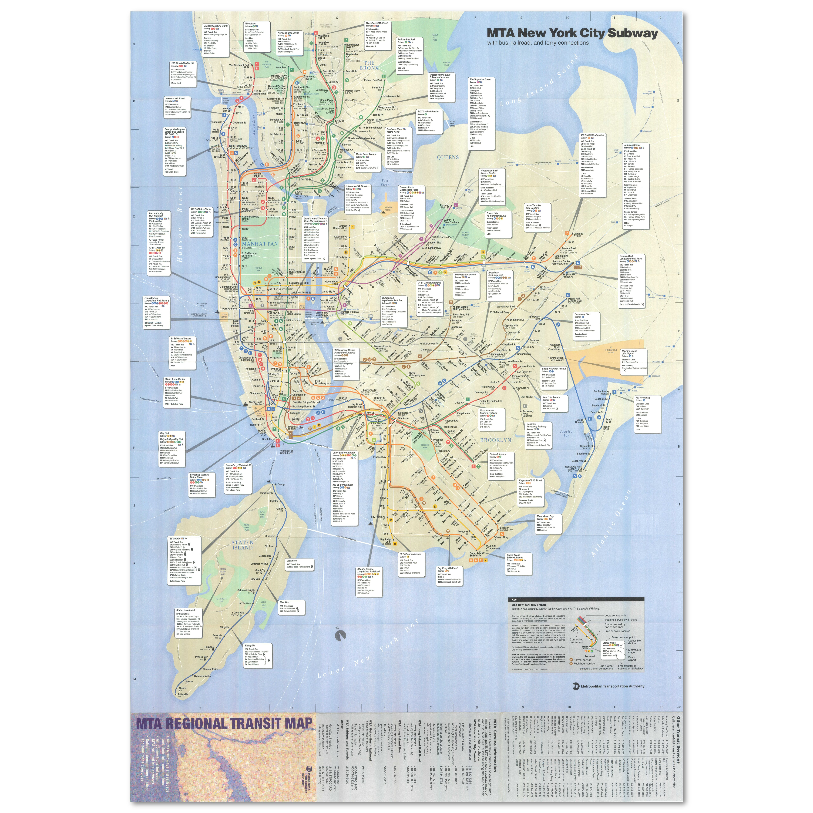

<!doctype html>
<html lang="en-US">
<head>
<meta charset="utf-8">
<meta http-equiv="X-UA-Compatible" content="IE=edge">
<meta name="viewport" content="width=device-width, initial-scale=1">
<title>Light Theme</title>
<link href="file:///C|/Users/josep.JW101/OneDrive/Documents/css/singlePageTemplate.css" rel="stylesheet" type="text/css">
<!--The following script tag downloads a font from the Adobe Edge Web Fonts server for use within the web page. We recommend that you do not modify it.-->

<!-- HTML5 shim and Respond.js for IE8 support of HTML5 elements and media queries -->
<!-- WARNING: Respond.js doesn't work if you view the page via file:// -->
<!--[if lt IE 9]>
      
      
    <![endif]-->
</head>
<body>
<!-- Main Container -->

 
  <!-- Navigation -->
  <header> <a href="">
    <h4 class="logo">Brown R train On the Web!</h4>
    </a>
    <nav>
      <ul>
        <li><a href="#hero">HOME</a></li>
        <li><a href="#about">ABOUT</a></li>
        <li> <a href="file:///C:/Users/josep.JW101/Downloads/Untitled-1.html">TRAINS OF NYC</a>
        <li><a href="my stuff and maps.html">My Creation</a></li>
    </nav>
  </header>
  <!-- Hero Section -->
  <section class="hero" id="hero">
    <h2 class="hero_header">Brown Rtrain on the Web!</h2>
    
Photos of the Brown R Train and more!&nbsp;

  </section>
  <!-- About Section -->
  <section class="about" id="about">
    <h2 class="hidden">About</h2>
    
What is the Brown R train and what is this website for?

    
&nbsp;

    
&nbsp;

    
&nbsp;

    
&nbsp;

    
Well, this website is basically a school project so yeah but its useful for me to learn code and how to navigate this application so yeah. this website is to document some bits of history of the nyc subway. the Brown R train was used in the mid 1980s for a short time along side the yellow R, running from chambers st and Bay ridge 95 st, Appaently it went to Metropolitan av at some point but i dont have anymore info to back me up on that.&nbsp;&nbsp;

    
&nbsp;

Who am i?

&nbsp;&nbsp;

Just a Train spotter and enthusiest from sydney australia, specializing in the london underground, sydney trains and the Nyc subway!

&nbsp;&nbsp;

What will i document on here?

&nbsp;&nbsp;

 stuff i make like maps, hard to find information, and other things from different time periods, also heres the L7 Cityrail logo letter &gt; ⇋

&nbsp;

&nbsp;

    
How long have you been into trains and what else if your interists?

&nbsp;

&nbsp;

&nbsp;I have been into trains since i was 5 years old, yes i knew what a waratah was somehow, and i just remember S sets in service aswell, other interess include basically all other modes of transport, blacksmithing aka forging, music, gaming and more&nbsp; &nbsp; &nbsp;

&nbsp;

&nbsp;

&nbsp;

&nbsp;

&nbsp;

&nbsp;....so yah thats all for that

  </section>
  <!-- Stats Gallery Section -->
  

    

      <h1 class="stats">15</h1>
      <h4>Years old&nbsp;</h4>
      
Born in november 2011

    

    

      <h1 class="stats">2016</h1>
      <h4>is when i started liking trains&nbsp;</h4>
      
Yea i remember going on S Sets

    

    

      <h1 class="stats">And also</h1>
      <h4>MY FAVOURIE TRAIN IS...&nbsp;&nbsp;</h4>
      
the tangara

    

    

      <h1 class="stats">And i like</h1>
      <h4>The</h4>
      
Nyc subway and London underground

    

  

  <!-- Parallax Section -->
  <section class="banner">
    <h2 class="parallax">A small bit of hostory of my favourite train, Tangaras</h2>
    
    
Sydneys tangara trains entered service in april 1988 and were called the 21st century train. he first to have plug doors and beeping noises when the doors closed. the livery changed in the 2000s to yellow and got new doors in 2018.in 2026 they will turn orange. T72 is my favourite set.

  </section>
  <!-- More Info Section -->
  <footer>
<article class="footer_column">
      <h3>&nbsp; LOCATION</h3>
</article>

&nbsp; 

&nbsp;

&nbsp; 

<article class="footer_column">  
  
I obviously wnt tell you my location hehe 

</article>
<article class="footer_column>
  
Now for photos of brown r trains

      
  
Yeah, looks scuffed but yeah

<a href="file:///C|/Users/josep.JW101/Downloads/1979 map in todays style.pdf">&nbsp;</a>
</article>
  </footer>
  <!-- Footer Section -->
  <section class="footer_banner" id="contact">
    <h2 class="hidden">Footer Banner Section </h2>
    
FOR THE LATEST NEWS &amp; UPDATES and more&nbsp;

Subscribe for $40 a week!

  </section>
  <!-- Copyrights Section -->

&copy;2026 - <strong>JW productions</strong>

<!-- Main Container Ends -->
</body>
</html>

<!doctype html>
<html>
<head>
<meta charset="utf-8">
<meta http-equiv="X-UA-Compatible" content="IE=edge">
<meta name="viewport" content="width=device-width, initial-scale=1">
<title>Light Theme</title>
<link href="css/simpleGridTemplate.css" rel="stylesheet" type="text/css">
</head>
<body>
<!-- Main Container -->

 
  <!-- Header -->
  <header class="header">
    <h4 class="logo">Brown R Train on the web!</h4>
  </header>
  <!-- Hero Section -->
  <section class="intro">
    

      <h3>Mta 1998 New look test map V2</h3>
       

    

      
Over time i have made many map creations using adobe illustator, below are them 

      
&nbsp;

    

  </section>
  <!-- Stats Gallery Section -->
  

    
 
      <h4><a href="file:///C:/Users/josep.JW101/Downloads/Destroying%20the%20Nyc%20subway%20map%20%234.pdf">Destrying the Nyc subway map (latest)</a></h4>
      
Destroying the map of the nyc subway

      
This one was a project that has the most edits to, this was inspied by the destroying the tube&nbsp; map and my destroyng the sydney trains map.

    

    
 
      <h4><a href="file:///C:/Users/josep.JW101/Downloads/destroying%20the%20sydney%20trains%20network%20map%205.pdf">Destroying the Sydney trains map (latest)</a></h4>
      
Destroying of hte map of sydney trains

      
This was created earlier than the nyc subway one, so yeah.

    

    
 
      <h4><a href="file:///C:/Users/josep.JW101/Downloads/The%20Nyc%20subway%20map%202003%20In%20modern%20style.pdf">2003 nyc subway map in the modern style&nbsp; &nbsp;&nbsp;</a></h4>
      
The 2003 in the modern vingelli like style

      
The first one of the old maps in the modern style, it took a small bit to finish

    

    
 
      <h4><a href="file:///C:/Users/josep.JW101/Downloads/Coffeeshop%20Images-20260818T002202Z-1-001/1979%20map%20in%20todays%20style.pdf">1979 Nyc subway map in the modern style</a></h4>
      
The same as the left one but from 1979

      
This one took me MONTHS and i mean months, at the best part 4, it ended up looking alright in the end so yeah

    

  

  

    
 
      <h4><a href="file:///C:/Users/josep.JW101/Downloads/[YTP]%20BORING%20ARCHEOLIGY%20SUBWAYS.mp4">Suprtoe subway archaeoligy (YTP) Ep:1</a></h4>
      
[YTP] BORING ARCHAEOLIGY SUBWAYS!!!!&nbsp;

      
the first YTP that i made in canva, looking back it was somewhat a crappily made vido but yeah&nbsp; &nbsp;

    

    
 
      <h4><a href="[YTP] BORING ARCHAROLEGY SUBWAYS RETURN!!1! (1).mp4">Suprtoe Subway archaeoligy (YTP) Ep:2</a></h4>
      
[YTP] BORING ARCHAEOLIGY SUBWAYS RETURN!!!!!!

      
the second installation of Boring archaeoligy subways, also made in canva

    

    
 
      <h4><a href="file:///C:/Users/josep.JW101/Downloads/Silverlink%20metro%20map.pdf">Silverlink Metro map&nbsp;</a></h4>
      
A custom rail map

      
Spawn transport is my fantasy rail system and this is silverlink metro, a nycsubway style system with currently 1 line.

    

    
 
      <h4>2026 nyc subway map in the 1997 style (unfinished)&nbsp;</h4>
      
Blank

      
The first map to be fully made in the illustrator app as all other maps were mainly made in the web version

    

  

  <!-- Footer Section -->
  <footer id="contact">
    
GET IN TOUCH WITH ME... or not

    
EMAIL ME 

  </footer>
  <!-- Copyrights Section -->
  
&copy;2026 - <strong>MarvelousjW</strong>

<!-- Main Container Ends -->
</body>
</html>

<!doctype html>
<html>
<head>
<meta charset="utf-8">
<meta http-equiv="X-UA-Compatible" content="IE=edge">
<meta name="viewport" content="width=device-width, initial-scale=1">
<title>Light Theme</title>
<link href="file:///C|/Users/josep.JW101/Downloads/css/simpleGridTemplate.css" rel="stylesheet" type="text/css">
</head>
<body>
<!-- Main Container -->

 
  <!-- Header -->
  <header class="header">
    <h4 class="logo">Brown R train on the Web!&nbsp;</h4>
  </header>
  <!-- Hero Section -->
  <section class="intro">
    

<h3>Trains of NYC&nbsp;</h3>
       

    

      
The Nyc subway has tons of different trains of different types and builders across its history, it was the 1940s when the Ind (interborugh rapid transit company) created the R type cars, and have continued that designation untill today... some of these types will be shown below, below this text is each R type car name...&nbsp; &nbsp; &nbsp; 

      
R1, R4, R6-1, R6-2, R6-3, R7, R7A, R9, R10, R11, R12, R14, R15, R16, R17, R21, R22, R25, R26, R27, R28, R29, R30, R32, R33, R34, R36, R38, R40S, R40M, R42, R44, R46, R62, R62A, R68, R68A, R110A, R110B, R142, R142A, R143, R160A, R160B-1, R160B-2, R179, R211A, R211S, R211T&nbsp;

    

  </section>
  <!-- Stats Gallery Section -->
  

    
 
      <h4><a href="../../../Downloads/Coffeeshop Images-20260818T002202Z-1-001/Untitled-1.html">R1-R9</a></h4>

The Arnines

      
The R1-9 trains, also known as Arnines were the first trains to have the R designation, the first were built in 1932 for the IND A line (8 av line) and also ran on other lines like the BMT owned lines, they were retired in the 1970s due to old age, there is a full set preserved. Note R7A car 1575 Was wrecked in 1946 and became a prototype for the R10 (preserved)&nbsp; &nbsp;

    

    
 
      <h4>R10</h4>
      
The first SMEE type train

      
The First SMEE type trains, similar to the R12 but the R10 was built first and are of IND/BMT dimensions.

    

    
 
      <h4>R32</h4>
      
The Brightliners

      
The R32 was a revilutionary train being made by Budd.

    

    
 
      <h4>R33/R36</h4>
      
The IRT redbirds

      
The R33 like the R32 were famous trains with these running on all Irt lines.

    

  

  

    
 
      <h4>R40S/M</h4>
      
HTML, CSS, JS, WordPress

      
The R40 slant was one of the most interesting trains but a major saftey hazard, which led to the creation of the R40M

    

    
 
      <h4>R46</h4>
      
The 75 footers

      
Lorem ipsum dolor sit amet, consectetur adipisicing elit, sed do eiusmod tempor incididunt ut labore et dolore magna aliqua.

    

    
 
      <h4>R160/A/B</h4>
      
the 3 NTT train&nbsp;

      
Lorem ipsum dolor sit amet, consectetur adipisicing elit, sed do eiusmod tempor incididunt ut labore et dolore magna aliqua.

    

    
 
      <h4>R211A/S/T</h4>
      
The newest subway car

      
The R211 at this point in time is the newest subway car that is built, The train runs on the A,CE,B,D,G and sometimes the F line. The R211S if for the staten island railway replacing the R44s on the line, the R211T is an open gangway train that mainly operates on the G. interestingly, this photo shows the destination as gravesend 86 st, the name gravesend has not been used since the 2000s&nbsp; &nbsp;&nbsp;

    

  

  <!-- Footer Section -->
  <footer id="contact">
    
GET IN TOUCH WITH ME or HET or MTA or TFL or JW PRODUCTIONS

    
EMAIL ME 

  </footer>
  <!-- Copyrights Section -->
  
&copy;2026 - <strong>GRID</strong>

<!-- Main Container Ends -->
</body>
</html>
